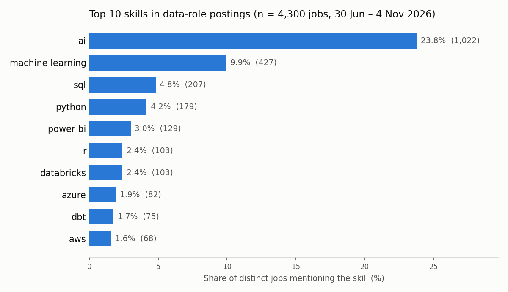

# Job-listing skills analysis

This project tracks which skills European data-role job postings ask for. It collects postings for five data roles every week. It then counts how often each skill appears, so I can decide what to learn next.

> **Work in progress, as of 2026-11-05.** The pipeline runs weekly and has collected data since 30 June 2026. The personal skill-gap list, trend charts and a dashboard are not built yet.

The target roles are data analyst, data scientist, business intelligence analyst, business intelligence developer and analytics engineer.

## Sources

| Source | Access | Coverage | Why it is here |
|---|---|---|---|
| [Adzuna](https://www.adzuna.com) | REST API with a free key | Country boards for Germany, Switzerland and Spain | Most of the volume. Descriptions are cut at 500 characters. |
| [Remotive](https://remotive.com) | Keyless JSON API, one search per role | Global remote jobs | Full descriptions and a clean employment-type tag. |
| [Remote OK](https://remoteok.com) | Keyless JSON feed, filtered to the target roles locally | Global remote jobs | Extra remote volume with full descriptions. |
| [We Work Remotely](https://weworkremotely.com) | All-jobs RSS feed, filtered to the target roles locally | Global remote jobs | Extra remote volume with full descriptions. |

LinkedIn and Indeed are left out on purpose. The project uses only official APIs and public feeds, which stay legal and stable.

## How it works

1. **Fetch.** Each source implements one `Source` interface (`jobskills/sources.py`) and maps its fields into a shared `NormalizedPosting` schema (`jobskills/schema.py`). One failing source does not stop the others.
2. **Raw store.** Every run appends its postings to a timestamped JSONL file. The clean layer can be rebuilt from these files at any time.
3. **Clean.** `jobskills/clean.py` loads postings into SQLite. It upserts on the posting `id` and records `first_seen` and `last_seen`, so the database shows how long a listing stays open.
4. **Extract.** `jobskills/extract.py` matches each description against a hand-curated taxonomy (`jobskills/skills.yaml`, with German and Spanish aliases). It stores one row per job and skill.
5. **Analyse.** The notebooks count skill demand per distinct job. A normalised company-and-title key collapses the same job found under several role searches.

## Current findings

The numbers come from 4,300 distinct jobs, collected on 11 dates between 30 June and 4 November 2026. Adzuna supplies 4,234 of them, Remotive 56, We Work Remotely 6 and Remote OK 4. Vacancy data comes from [Adzuna](https://www.adzuna.com) and the remote boards listed above.



- **"AI" is the most requested skill in every role.** It appears in 34% of data-scientist jobs, 30% of analytics-engineer jobs, 13% of data-analyst jobs and 7% of BI jobs.
- **Each role has its own profile.** Data scientists add machine learning (21%). Analytics engineers add Databricks (6.5%), SQL (6.5%) and dbt (5.6%). Data analysts add SQL (5.7%) and Power BI (5.5%).
- **Description length limits skill matching more than the taxonomy does.** Adzuna's descriptions have a median of 500 characters, and 42% of its jobs match any skill. Remotive's descriptions have a median of about 3,900 characters, and 84% of its jobs match. This is why the shares in the chart are low: most jobs come from Adzuna's truncated text.
- **Part-time data jobs are rare.** Only 52 of 4,300 jobs (1.2%) are tagged part-time.
- **Employment type depends on the source.** Adzuna leaves 74% of jobs without an employment type. Remotive tags every job, and 12.5% of its jobs are part-time.

The notebooks in `notebooks/` hold the full analysis:

| Notebook | Question |
|---|---|
| `01_first_analysis.ipynb` | Which skills appear most often? |
| `02_ngram_mining.ipynb` | Which frequent terms are missing from the taxonomy? |
| `03_role_demand.ipynb` | How does skill demand differ by role? (heatmap) |
| `04_employment_type.ipynb` | How common is part-time work, and which source reports it? |

## Weekly schedule

A macOS launchd agent runs `run_weekly.sh`, which calls `python -m jobskills.run_weekly` (fetch → raw store → clean → extract).

- **Triggers.** The agent fires on Monday, Wednesday and Friday at 09:00 and 15:00, and once at login. A laptop that was asleep or off still gets its weekly run.
- **One run per week.** After a successful run the script stamps the ISO week. Every later trigger in that week exits at once.
- **No overlap.** A lock directory stops two triggers from running at the same time. A lock older than one hour counts as stale and is removed.
- **Retry on failure.** Exit code 3 means a critical source failed. The postings that did arrive are still loaded, but the week stays unclaimed, so the next trigger retries.
- **Backup.** After each run the script pushes a snapshot of the database to a private repository. `first_seen` dates cannot be collected again later, so the database must not be lost.
- **Log.** Both output streams go to `data/logs/weekly.log`, which is gitignored.

The launchd plist lives in `~/Library/LaunchAgents/` and is not part of this repository. `run_weekly.sh` uses absolute paths for my machine, so edit them before you use it elsewhere.

## How to run

Requires Python 3.11.

```bash
python3.11 -m venv venv
./venv/bin/pip install -r requirements-lock.txt
cp .env.example .env            # then add your Adzuna app ID and key
./venv/bin/python -m jobskills.run_weekly
./venv/bin/python -m pytest
```

Adzuna keys are free at [developer.adzuna.com](https://developer.adzuna.com). The other three sources need no key. Open the notebooks with `./venv/bin/jupyter lab` after the first run has filled `data/jobs.db`.

Raw postings and the database stay local and are gitignored. `data/sample/` holds small synthetic samples that show the data shape. A GitHub Actions workflow runs the test suite on Python 3.11.

## Repository layout

```
jobskills/        pipeline package: sources, fetchers, raw store, clean, extract, taxonomy
notebooks/        analysis notebooks 01–04
tests/            pytest suite
data/sample/      synthetic sample records
docs/             README chart
run_weekly.sh     wrapper for the scheduled run
design-tree.md    design decisions and build log
```

## Limitations

- **The role is the search query.** A job's role is the query that found it, not the role the posting describes.
- **The remote boards add little volume.** Remote OK and We Work Remotely publish one whole feed, and only a few titles match the target roles.
- **Deduplication is exact.** The company-and-title key can merge two real openings with the same title, and it misses near-duplicates.
- **Truncation lowers every share.** Adzuna's 500-character limit hides skills that appear later in a description.

## Next steps

- A personal skill-gap list that ranks skills by demand and by what I have not learned yet.
- Skill-demand trends over the weekly snapshots.
- A Streamlit dashboard for the trends.
- A relevance filter for off-target postings and fuzzy deduplication.

## Data sources and attribution

This is a personal research project. It publishes aggregate counts only, never individual postings.

- Vacancy data from [Adzuna](https://www.adzuna.com), used under the [Adzuna API terms](https://developer.adzuna.com/docs/terms_of_service).
- Remote jobs from [Remotive](https://remotive.com), under the [Remotive API terms](https://github.com/remotive-com/remote-jobs-api).
- Remote jobs from [Remote OK](https://remoteok.com), under the terms in the `legal` field of [its API](https://remoteok.com/api).
- Remote jobs from [We Work Remotely](https://weworkremotely.com), read from its public RSS feed.

## License

MIT. See [LICENSE](LICENSE).
