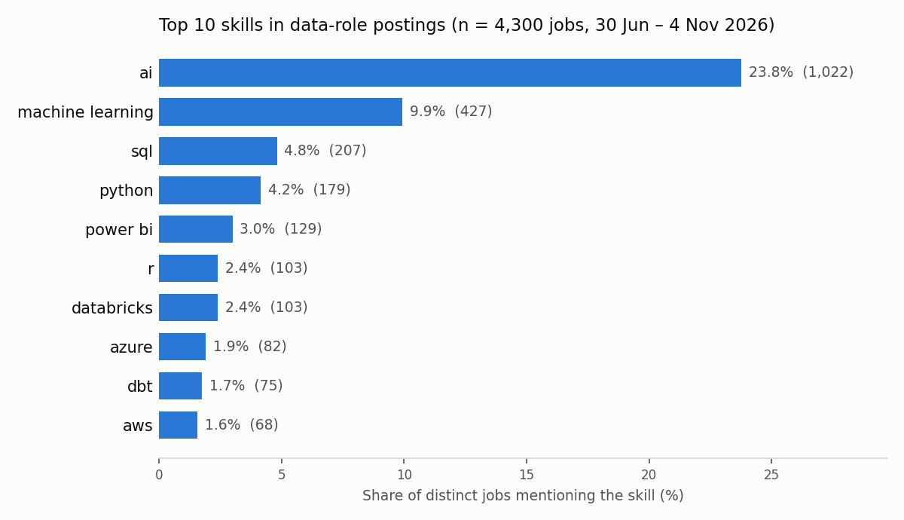

# Job-listing skills analysis

This project tracks which skills European data-role job postings ask for. It collects postings for five data roles every week. It then counts how often each skill appears, so I can decide what to learn next.

> **Work in progress, as of 2026-11-05.** The pipeline runs weekly and has collected data since 30 June 2026. The personal skill-gap list, trend charts and a dashboard are not built yet.

The target roles are data analyst, data scientist, business intelligence analyst, business intelligence developer and analytics engineer.

## Sources

| Source | Access | Coverage | Why it is here |
|---|---|---|---|
| [Adzuna](https://www.adzuna.com) | REST API with a free key | Country boards for Germany, Switzerland and Spain | Most of the volume. Descriptions are cut at 500 characters. |
| [Remotive](https://remotive.com) | Keyless JSON API, one search per role | Global remote jobs | Full descriptions and a clean employment-type tag. |
| [Remote OK](https://remoteok.com) | Keyless JSON feed, filtered to the target roles locally | Global remote jobs | Extra remote volume with full descriptions. |
| [We Work Remotely](https://weworkremotely.com) | All-jobs RSS feed, filtered to the target roles locally | Global remote jobs | Extra remote volume with full descriptions. |

LinkedIn and Indeed are left out on purpose. The project uses only official APIs and public feeds, which stay legal and stable.

## How it works

1. **Fetch.** Each source implements one `Source` interface (`jobskills/sources.py`) and maps its fields into a shared `NormalizedPosting` schema (`jobskills/schema.py`). One failing source does not stop the others.
2. **Raw store.** Every run appends its postings to a timestamped JSONL file. The clean layer can be rebuilt from these files at any time.
3. **Clean.** `jobskills/clean.py` loads postings into SQLite. It upserts on the posting `id` and records `first_seen` and `last_seen`, so the database shows how long a listing stays open.
4. **Extract.** `jobskills/extract.py` matches each description against a hand-curated taxonomy (`jobskills/skills.yaml`, with German and Spanish aliases). It stores one row per job and skill.
5. **Analyse.** The notebooks count skill demand per distinct job. A normalised company-and-title key collapses the same job found under several role searches.

## Current findings

The numbers come from 4,300 distinct jobs, collected on 11 dates between 30 June and 4 November 2026. Adzuna supplies 4,234 of them, Remotive 56, We Work Remotely 6 and Remote OK 4. Vacancy data comes from [Adzuna](https://www.adzuna.com) and the remote boards listed above.



- **"AI" is the most requested skill in every role.** It appears in 34% of data-scientist jobs, 30% of analytics-engineer jobs, 13% of data-analyst jobs and 7% of BI jobs.
- **Each role has its own profile.** Data scientists add machine learning (21%). Analytics engineers add Databricks (6.5%), SQL (6.5%) and dbt (5.6%). Data analysts add SQL (5.7%) and Power BI (5.5%).
- **Description length limits skill matching more than the taxonomy does.** Adzuna's descriptions have a median of 500 characters, and 42% of its jobs match any skill. Remotive's descriptions have a median of about 3,900 characters, and 84% of its jobs match. This is why the shares in the chart are low: most jobs come from Adzuna's truncated text.
- **Part-time data jobs are rare.** Only 52 of 4,300 jobs (1.2%) are tagged part-time.
- **Employment type depends on the source.** Adzuna leaves 74% of jobs without an employment type. Remotive tags every job, and 12.5% of its jobs are part-time.

The notebooks in `notebooks/` hold the full analysis:

| Notebook | Question |
|---|---|
| `01_first_analysis.ipynb` | Which skills appear most often? |
| `02_ngram_mining.ipynb` | Which frequent terms are missing from the taxonomy? |
| `03_role_demand.ipynb` | How does skill demand differ by role? (heatmap) |
| `04_employment_type.ipynb` | How common is part-time work, and which source reports it? |
| `05_sql.ipynb` | Runs the SQL files below against the snapshot. |

## SQL analysis (DuckDB)

This part of the project is written in plain SQL. Each analysis is a numbered file in [`sql/`](sql/), and each file has a pytest test against a small hand-made fixture. The queries run in [DuckDB](https://duckdb.org) against one frozen copy of the pipeline's SQLite database, dated **2026-11-10**. DuckDB reads the SQLite file directly, so the snapshot needs no conversion. It also offers `FILTER`, `QUALIFY` and good date functions.

The SQL uses CTEs, conditional aggregation (`count(DISTINCT …) FILTER (WHERE …)`), `ROLLUP`, window functions (`RANK`, `DENSE_RANK`, `LAG`, running `SUM`), a gaps-and-islands query and `QUALIFY`.

### Question

How does skill demand for data roles in **Switzerland** differ from Germany and Spain? Two follow-up questions use the same data. How long do postings stay visible? Does skill demand shift over the four months?

### Data

| Item | Value |
|---|---|
| Snapshot | `data/snapshots/jobs_2026-11-10.db`, read-only, gitignored |
| Tables | `jobs` (one row per posting) and `skill_hits` (one row per posting and skill) |
| Rows | 7,182 postings and 5,482 skill hits |
| Scrape dates | 12, from 30 June to 10 November 2026 |
| Regions | Switzerland 1,094 · Germany 3,210 · Spain 2,806 · 72 remote-board rows with no country |

The snapshot stays out of the repository for the same terms-of-service reason as the live database. The README reports aggregate counts only.

### Cleaning: audit first

The audit files report problems and change nothing. Each check reconciles back to the 7,182 rows.

| File | Check | Finding |
|---|---|---|
| `01_row_counts.sql` | Snapshot vs live database | 18 of 18 counts match (totals, per scrape date, per region). |
| `02_audit_dedup.sql` | Duplicate jobs | 4,501 distinct jobs + 2,609 surplus rows + 72 rows without a key = 7,182. One ad appears 198 times. Adzuna often re-posts a job under a new id. |
| `02_audit_salary.sql` | Salary coverage | 17.1% of rows have a salary, all from Adzuna: Spain 35.1%, Germany 6.4%, Switzerland 3.6%. 8 values are implausible. |
| `02_audit_remote.sql` | Work mode | 90.1% of rows are `unknown`, because Adzuna cuts descriptions at about 500 characters. |
| `02_audit_scrape_calendar.sql` | Missed weeks | 9 weeks in a row have no scrape (6 July to 31 August). The 28 September run found 1 posting. |

The audit shaped the analysis in three ways:

- **A job is counted once.** The queries identify a job by `coalesce(dedup_key, 'id:' || id)`. The `dedup_key` is a normalised company-and-title key. Rows without a key keep their own id.
- **The skill `r` is excluded** from the country comparison. Its case-sensitive matcher mostly hits "R&D", not the R language.
- **Time is measured in full scrapes.** A full scrape is a date on which Adzuna returned rows. On 28 September only Remotive ran, so the trend file leaves that date out.

### Result: Switzerland vs Germany and Spain

`03_country_skill_demand.sql` gives one row per skill. For each country it returns distinct jobs, the share of that country's jobs and a rank. The denominators are 861 Swiss, 1,751 German and 1,974 Spanish distinct jobs.

| Skill | Switzerland | Germany | Spain |
|---|---|---|---|
| ai | #1 (25.3%) | #1 (17.9%) | #1 (27.3%) |
| machine learning | #2 (8.5%) | #2 (6.7%) | #2 (12.5%) |
| sql | #3 (4.3%) | #5 (2.1%) | #3 (6.9%) |
| python | #4 (3.8%) | #6 (1.9%) | #4 (5.5%) |
| databricks | #5 (2.6%) | #4 (2.3%) | #7 (2.1%) |
| statistics | **#6** (2.4%) | #8 (1.3%) | #22 (0.7%) |
| power bi | **#9** (1.6%) | #3 (3.1%) | #5 (3.5%) |
| spark | **#12** (1.2%) | #21 (0.3%) | #14 (1.5%) |
| java | **#13** (1.0%) | #23 (0.2%) | #33 (0.2%) |
| dbt | #15 (0.9%) | #11 (0.9%) | **#6** (2.6%) |

- **The top two skills are the same everywhere.** `ai` and `machine learning` lead in all three countries.
- **Switzerland leans towards statistics and engineering.** Statistics, Spark and Java rank higher there than in Germany or Spain.
- **Switzerland ranks Power BI lower.** Power BI is #9 in Switzerland, but #3 in Germany and #5 in Spain.
- **Spain leans towards dbt.** dbt ranks #6 in Spain, #11 in Germany and #15 in Switzerland.

Compare the ranks, not the shares. The share of jobs that match any skill differs by country (Switzerland 44%, Germany 34%, Spain 47%). That lowers every share unevenly.

### Result: posting lifetime and trends

- **The scrape calendar has three runs of weeks.** `04a_scrape_calendar.sql` runs a gaps-and-islands query on the weekly calendar. The runs are 30 June, 9–22 September and 5 October to 10 November. The longest gap is 71 days.
- **Most postings vanish quickly.** `04b_posting_lifetime.sql` groups postings by their first-seen date. Of 7,182 postings, 3,708 were seen on one date only, and 1,792 were still visible on 10 November. The median visible lifetime of closed postings is 0–8 days in every group except the single 28 September posting.
- **Demand for `ai` is stable.** `04c_skill_trends.sql` tracks each skill's share of open postings on every full scrape. `ai` stays between 21% and 23%. From 30 June to 10 November, Power BI falls from 5.6% to 3.7%, and GCP rises from 0.4% to 1.9%. These moves rest on small counts.

### How to run the SQL

The tests need no real data. They load hand-made fixtures into an in-memory DuckDB, and CI runs them on every push.

```bash
./venv/bin/python -m pytest tests/test_sql_*.py
```

To run the queries on real data, first collect postings with the pipeline (see [How to run](#how-to-run)). Then copy the database to the snapshot path and run any file:

```bash
mkdir -p data/snapshots
cp data/jobs.db data/snapshots/jobs_2026-11-10.db
./venv/bin/python -c "from jobskills.sql_runner import connect, run; print(run(connect(), '03_country_skill_demand.sql').head(10))"
```

`jobskills/sql_runner.py` attaches the SQLite file read-only, so the `.sql` files use bare table names. The first attach downloads DuckDB's SQLite extension, which needs a network connection once. On your own data the numbers will differ from the ones above. `notebooks/05_sql.ipynb` runs the same files.

### Limits

- **Truncated descriptions lower every share.** Adzuna cuts descriptions at about 500 characters, so a skill named later in an ad is missed.
- **Counts are small below the top skills.** Below the 12th skill, every Swiss and German count is under 15 jobs.
- **Lifetime means visibility, not the real opening period.** Adzuna returns at most 250 postings per country and role. A posting can drop out of the fetch while it is still listed.
- **Open postings are an assumption.** Only the first and last sighting are stored, so the trends assume a posting stayed listed in between.
- **The match rate rises over time.** Among new postings it rises from 35–40% (up to 5 October) to 43–48% (from 17 October). That lifts every later trend share, so read the trend lines against each other.
- **The 9-week gap hides endings.** A posting first seen on 30 June ended at some point before 9 September.
- **Salaries are not converted.** Swiss salaries are in CHF, the others in EUR.
- **Counting units differ between files.** The country comparison counts distinct jobs, but the lifetime and trend files count posting rows. The trend file also still includes `r`.
- **Two calendar queries overlap.** `02_audit_scrape_calendar.sql` and `04a_scrape_calendar.sql` both build the scrape calendar.

## Weekly schedule

A macOS launchd agent runs `run_weekly.sh`, which calls `python -m jobskills.run_weekly` (fetch → raw store → clean → extract).

- **Triggers.** The agent fires on Monday, Wednesday and Friday at 09:00 and 15:00, and once at login. A laptop that was asleep or off still gets its weekly run.
- **One run per week.** After a successful run the script stamps the ISO week. Every later trigger in that week exits at once.
- **No overlap.** A lock directory stops two triggers from running at the same time. A lock older than one hour counts as stale and is removed.
- **Retry on failure.** Exit code 3 means a critical source failed. The postings that did arrive are still loaded, but the week stays unclaimed, so the next trigger retries.
- **Backup.** After each run the script pushes a snapshot of the database to a private repository. `first_seen` dates cannot be collected again later, so the database must not be lost.
- **Log.** Both output streams go to `data/logs/weekly.log`, which is gitignored.

The launchd plist lives in `~/Library/LaunchAgents/` and is not part of this repository. `run_weekly.sh` uses absolute paths for my machine, so edit them before you use it elsewhere.

## How to run

Requires Python 3.11.

```bash
python3.11 -m venv venv
./venv/bin/pip install -r requirements-lock.txt
cp .env.example .env            # then add your Adzuna app ID and key
./venv/bin/python -m jobskills.run_weekly
./venv/bin/python -m pytest
```

Adzuna keys are free at [developer.adzuna.com](https://developer.adzuna.com). The other three sources need no key. Open the notebooks with `./venv/bin/jupyter lab` after the first run has filled `data/jobs.db`.

Raw postings and the database stay local and are gitignored. `data/sample/` holds small synthetic samples that show the data shape. A GitHub Actions workflow runs the test suite on Python 3.11.

## Repository layout

```
jobskills/        pipeline package: sources, fetchers, raw store, clean, extract, taxonomy
notebooks/        analysis notebooks 01–05
sql/              DuckDB queries for the SQL analysis
tests/            pytest suite
data/sample/      synthetic sample records
docs/             README chart
run_weekly.sh     wrapper for the scheduled run
design-tree.md    design decisions and build log
```

## Limitations

- **The role is the search query.** A job's role is the query that found it, not the role the posting describes.
- **The remote boards add little volume.** Remote OK and We Work Remotely publish one whole feed, and only a few titles match the target roles.
- **Deduplication is exact.** The company-and-title key can merge two real openings with the same title, and it misses near-duplicates.
- **Truncation lowers every share.** Adzuna's 500-character limit hides skills that appear later in a description.

## Next steps

- A personal skill-gap list that ranks skills by demand and by what I have not learned yet.
- Skill-demand trends over the weekly snapshots.
- A Streamlit dashboard for the trends.
- A relevance filter for off-target postings and fuzzy deduplication.

## Data sources and attribution

This is a personal research project. It publishes aggregate counts only, never individual postings.

- Vacancy data from [Adzuna](https://www.adzuna.com), used under the [Adzuna API terms](https://developer.adzuna.com/docs/terms_of_service).
- Remote jobs from [Remotive](https://remotive.com), under the [Remotive API terms](https://github.com/remotive-com/remote-jobs-api).
- Remote jobs from [Remote OK](https://remoteok.com), under the terms in the `legal` field of [its API](https://remoteok.com/api).
- Remote jobs from [We Work Remotely](https://weworkremotely.com), read from its public RSS feed.

## License

MIT. See [LICENSE](LICENSE).
